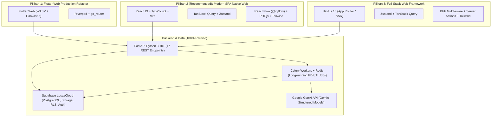
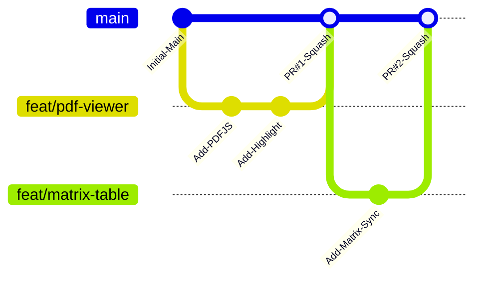

# Blueprint Arsitektur Web & Rencana Transisi: Modellyng

> **Dokumen Rekomendasi Senior Software Architect**  
> **Status Basis Data & Backend:** 80% Selesai (FastAPI + Celery + Supabase RLS Stabil)  
> **Target Transisi:** Aplikasi Web Produksi Berkinerja Tinggi (*High-Performance Web SaaS*)  
> **Ukuran Tim Pengembang:** 3 Orang (*Small Agile Team*)

---

## 1. Pendekatan Strategis Arsitektur

Berdasarkan audit menyeluruh pada [audit_fitur_dan_state_modellyng.md](file:///C:/Users/hp/.gemini/antigravity-ide/brain/7957e6e6-0d25-4349-8a35-80e6b5a89f29/audit_fitur_dan_state_modellyng.md), aplikasi Modellyng memiliki keunggulan kompetitif yang sangat besar: **80% logika bisnis berat sudah selesai, teruji, dan stabil di lapisan Backend & Database**:
- 21 migrasi SQL di Supabase dengan Row Level Security (RLS) multi-tenant yang terisolasi ketat.
- Worker asinkronus Celery + Redis untuk ekstraksi PyMuPDF, chunking teks, dan inferensi Gemini.
- Pipeline komparasi 5-tahap deterministik, perhitungan saturasi graf, algoritma spring layout, RAG pipeline untuk dual chatbot, hingga generator ekspor Word/Excel/CSV/PPTX/PDF.

**Prinsip Utama Transisi:**  
> *"Never rewrite a working backend."*  
> Fokus pivot ke Web adalah **memodernisasi lapisan presentasi (Frontend Client), interaktivitas kanvas grafis, serta pengalaman pembacaan PDF langsung di browser**, dengan mempertahankan 100% API contract, schema database, dan worker processing yang telah berjalan.

---

## 2. Tiga Pilihan Arsitektur & Tech-Stack Web

Berikut adalah 3 opsi arsitektur terbaik yang relevan untuk mengakomodasi seluruh 14 kategori fitur Modellyng:



---

### Pilihan 1: Flutter Web Production Refactor (Low-Effort, Maximum Reuse)

Mempertahankan Flutter namun beralih target build 100% ke **Flutter Web**, menggunakan kompiler WebAssembly (WASM) dan CanvasKit rendering terbaru (Flutter 3.22+ / Dart 3.4+).

#### 1. Daftar Teknologi
- **Frontend:** Flutter Web (Dart 3.x), `flutter_riverpod ^3.4.2`, `go_router ^17.5.0`, `dio ^5.11.0`, `flutter_mermaid`, `graphview`, `pdfrx` (CanvasKit web renderer).
- **Backend:** Python FastAPI (Tetap sama, tanpa perubahan).
- **Jobs & Queue:** Celery + Redis (Tetap sama).
- **Database & Auth:** Supabase PostgreSQL + Auth + Private Storage (Tetap sama).

#### 2. Kelebihan
- **Kecepatan Migrasi Tercepat (1–2 Minggu):** 100% kode `models/`, `data/` repository, kalkulasi state Riverpod, dan ~80% widget yang ada langsung dapat dipakai ulang.
- **Biaya & Risiko Migrasi Terendah:** Tim tidak perlu mempelajari framework baru atau menulis ulang 23 screen dari awal ke bahasa lain.
- **Konsistensi Visual:** Logika *interactive viewer* kanvas alur riset dan graf 5000px sudah diimplementasikan di Flutter.

#### 3. Kekurangan
- **Ukuran Bundle Awal Sangat Besar:** Flutter Web CanvasKit/WASM memerlukan download runtime awal sekitar 12–18 MB, menyebabkan *first contentful paint* (FCP) terasa lambat di koneksi standar.
- **Interaksi DOM & Seleksi Teks Tidak Alami:** Teks dirender di atas kanvas grafis (HTML Canvas/WebGL), sehingga seleksi teks, klik kanan bawaan browser, ekstensi browser (seperti grammar checker/translator), dan aksesibilitas screen reader tidak sebaik web HTML native.
- **Penanganan PDF di Web Terbatas:** Paket `pdfrx` pada web bergantung pada canvas rendering yang berat; scrolling dokumen PDF 50 halaman terasa kurang mulus dibanding viewer berbasis HTML text layer.

#### 4. Analisis Skalabilitas Masa Depan
Kurang ideal untuk jangka panjang jika aplikasi ditargetkan sebagai SaaS komersial skala luas. Cocok hanya jika targetnya adalah **rilis web instan untuk demo/internal pilot** tanpa waktu pengembangan yang panjang.

---

### Pilihan 2 (RECOMMENDED): Modern SPA Native Web (React 19 + TypeScript + Vite + Tailwind CSS / Shadcn UI)

Membangun frontend web baru berbasis Single Page Application (SPA) yang bersih, modular, dan cepat, langsung mengonsumsi 47 endpoint FastAPI dan Supabase Auth eksisting.

#### 1. Daftar Teknologi
- **Frontend Framework:** React 19 / 18 + TypeScript + Vite (Build tool kilat dengan Hot Module Replacement).
- **State Management:**
  - **Server State & Caching:** `TanStack Query v5` (`@tanstack/react-query`) — Menggantikan Riverpod `FutureProvider`, menangani auto-refetch, polling job Celery, caching in-memory, dan invalidasi query otomatis.
  - **Client/UI State:** `Zustand` — Mengelola state UI lokal (modal, sidebar toggle, target highlight text).
- **Routing:** `TanStack Router` atau `React Router v7` — Routing tipe aman (*type-safe*), route guards autentikasi, dan sync parameter URL (`?page=2&blockId=...`).
- **HTTP Client & Types:** `Axios` atau native `fetch` + `openapi-typescript` (Men-generate interface TypeScript 100% otomatis langsung dari OpenAPI JSON FastAPI!).
- **Komponen UI & Styling:** `Tailwind CSS v4` + `Shadcn UI` (berbasis Radix UI primitives) — Komponen aksesibel, performa tinggi, dan mudah disesuaikan dengan Design System Modellyng.
- **Penampil PDF & Sorotan Teks:** `@react-pdf-viewer/core` / `pdfjs-dist` (Mozilla PDF.js) — Standar emas web untuk merender PDF privat dari byte array, mendukung layer teks native, zooming tajam, dan penyorotan teks (*quote highlight overlay*) instan.
- **Visualisasi Kanvas & Graf:**
  - **Peta Alur Riset & Knowledge Graph:** `React Flow` (`@xyflow/react`) — Library kanvas interaktif terbaik di ekosistem web; mendukung zoom, pan, minimap, custom nodes, bezier curves, dan clustering dengan performa 60 FPS.
  - **Flowchart Pasangan Paper:** `mermaid.js` terintegrasi langsung di web DOM.
- **Backend, Worker, DB:** FastAPI + Celery + Supabase (100% dipertahankan).

#### 2. Kelebihan
- **Performa Web Native & Waktu Muat Sub-Detik:** Bundle awal sangat ringan (< 500 KB gzipped) dengan code splitting dinamis (`React.lazy`).
- **Pengalaman Pengguna (UX) PDF & Kanvas Superior:** Seleksi teks asli pada PDF, highlight yang presisi per kata, serta kanvas graf node (*React Flow*) yang jauh lebih responsif, fleksibel, dan kaya fitur dibanding painter kustom Flutter.
- **Ekosistem & Ketersediaan Komponen Terbesar:** Komponen dropdown, modal, data-table dengan horizontal scroll sync, dan virtualisasi list untuk ratusan paper sudah tersedia dalam kualitas *enterprise*.
- **Otomatisasi Tipe Data (End-to-End Type Safety):** Skema Pydantic dari `backend/app/schemas.py` dapat diekspor langsung ke TypeScript dalam 1 perintah CLI.

#### 3. Kekurangan
- **Memerlukan Penulisan Ulang Layer Presentasi (UI):** Perlu mengonversi 23 file screen Flutter ke komponen React TSX.
- **Waktu Transisi:** Membutuhkan waktu sekitar **4 hingga 5 minggu** untuk tim 3 orang hingga seluruh fitur terimplementasi penuh.

#### 4. Analisis Skalabilitas Masa Depan
**Sangat Tinggi (Best-in-Class untuk B2B SaaS).** Pilihan ini adalah arsitektur standar industri yang dipakai oleh aplikasi serupa seperti Notion, Miro, Overleaf, dan ResearchRabbit. Memudahkan perekrutan developer web, mudah dipelihara, dan memiliki performa rendering browser yang tak tertandingi.

---

### Pilihan 3: Full-Stack Web Framework (Next.js 15 App Router / SSR + FastAPI Backend Tetap)

Mengadopsi arsitektur Full-Stack dengan Next.js 15 (Node.js runtime) sebagai portal web utama, dengan FastAPI tetap bertindak sebagai microservice terpisah untuk pekerjaan AI & Celery.

#### 1. Daftar Teknologi
- **Frontend & App Layer:** Next.js 15 (App Router, React Server Components), TypeScript, Tailwind CSS, Shadcn UI, Zustand, TanStack Query.
- **Auth Integration:** `@supabase/ssr` (Manajemen cookie session di level middleware server Next.js).
- **PDF & Visualisasi:** `pdfjs-dist` + `@xyflow/react` (Client Components).
- **Backend Service:** FastAPI Python (Tetap dipertahankan untuk Celery, PyMuPDF, RAG Chat, dan Gemini).

#### 2. Kelebihan
- **Dukungan SEO & Landing Page Terpadu:** Memungkinkan halaman publik (Welcome/Landing page, dokumentasi, pricing) di-render di server (*Server-Side Rendering*) untuk indeks Google sempurna, sementara dashboard aplikasi berjalan sebagai client component.
- **Server-Side Auth Validation:** Token JWT divalidasi langsung di edge middleware Next.js sebelum halaman dirender, mencegah *flicker* halaman saat loading login.
- **BFF (Backend-For-Frontend) Capability:** Route handler Next.js bisa memadukan panggilan API cepat tanpa mengekspos detail internal langsung ke browser.

#### 3. Kekurangan
- **Overhead Operasional Dual-Runtime:** Tim harus memelihara dua lingkungan server produksi: runtime Node.js (untuk Next.js) dan runtime Python (FastAPI + Celery + Redis).
- **Kompleksitas SSR pada Fitur Kanvas & PDF:** Library kanvas interaktif (React Flow) dan PDF.js tidak dapat berjalan di server (*requires window/DOM*), sehingga harus dibungkus dengan `'use client'` dan dynamic import (`ssr: false`), mengurangi manfaat inti dari App Router.
- **Terlalu Kompleks untuk Tim 3 Orang:** Membagi fokus tim kecil ke dua stack backend (Node.js + Python) meningkatkan beban maintenance dan *cognitive load*.

#### 4. Analisis Skalabilitas Masa Depan
Sangat bagus untuk perusahaan berskala menengah-besar yang memiliki tim marketing web dan tim produk terpisah. Namun untuk tahap Modellyng saat ini, opsi ini membawa kompleksitas berlebih (*over-engineering*).

---

### Matriks Perbandingan & Rekomendasi Keputusan

| Kriteria Evaluasi | Pilihan 1: Flutter Web | Pilihan 2: React 19 + Vite (Rekomendasi) | Pilihan 3: Next.js 15 SSR |
|---|---|---|---|
| **Kecepatan Migrasi** | 🟢 **Sangat Cepat (1-2 minggu)** | 🟡 **Sedang (4-5 minggu)** | 🔴 **Lambat (6-8 minggu)** |
| **Kualitas UX Penampil PDF** | 🔴 Rendah (Canvas, seleksi kaku) | 🟢 **Sangat Tinggi (Native Text Layer)** | 🟢 Sangat Tinggi (Native Text Layer) |
| **Interaktivitas Kanvas & Graf** | 🟡 Terbatas (Custom Painter) | 🟢 **Sangat Unggul (React Flow)** | 🟢 Sangat Unggul (React Flow) |
| **Performa & Initial Page Load** | 🔴 Lambat (12-18 MB WASM bundle) | 🟢 **Instan (< 500 KB Gzip)** | 🟢 Instan (SSR HTML awal) |
| **Beban Pemeliharaan (Tim 3 Orang)** | 🟢 Rendah (Satu bahasa client) | 🟢 **Ideal (Frontend modern + API Python)** | 🔴 Tinggi (Dual-runtime Node + Python) |
| **Kemudahan Perekrutan Talenta** | 🔴 Terbatas (Talenta Flutter Web langka) | 🟢 **Sangat Melimpah (Talenta React/TS)** | 🟢 Sangat Melimpah |

> **Rekomendasi Arsitek:**  
> **Pilihlah Pilihan 2 (React 19 + TypeScript + Vite + Tailwind CSS/Shadcn UI).**  
> Investasi migrasi selama 4–5 minggu akan terbayar lunas dengan kualitas penampil PDF yang tajam, kemampuan kanvas grafis kelas dunia dengan React Flow, waktu loading kilat, dan arsitektur SaaS modern yang siap diskalakan ke ribuan pengguna.

---

## 3. Desain Sistem & Panduan Penyelarasan UI (Design Tokens)

Untuk memastikan identitas visual Modellyng tetap konsisten, elegan, dan profesional saat bermigrasi ke Web, berikut adalah spesifikasi lengkap desain sistem yang diekstraksi dari basis kode [app_theme.dart](file:///d:/Koding/modeling%20by%20github/frontend/lib/src/theme/app_theme.dart), token canvas, dan audit fitur:

### A. Palet Warna (Color Palette & Semantic Tokens)

```text
Brand & Primary (Indigo AI Identity):
  Primary (Utama)       : #5147E5  | rgb(81, 71, 229)    -> Tombol utama, aksen aktif, link
  Primary Dark (Hover)  : #3730A3  | rgb(55, 48, 163)    -> State hover/pressed tombol utama
  Primary Soft (Surface): #EEECFF  | rgb(238, 236, 255)  -> Background icon, active nav, badge

Neutral & Background (Clean Academic Canvas):
  Canvas / Background   : #F6F7FB  | rgb(246, 247, 251)  -> Latar belakang halaman aplikasi
  Surface / Card        : #FFFFFF  | rgb(255, 255, 255)  -> Kontainer kartu, dialog, dropdown
  Ink (Teks Utama)      : #172033  | rgb(23, 32, 51)     -> Heading, judul card, teks kontras tinggi
  Muted (Teks Sekunder) : #667085  | rgb(102, 112, 133)  -> Subtitle, placeholder, metadata, timestamp
  Border (Garis Tepi)   : #E5E8EF  | rgb(229, 232, 239)  -> Divider, outline card, input border

Status & Semantik Akademis:
  Blue (Paper / Ingest) : #2878F0  | Soft: #EAF3FF       -> Indikator paper, tab dokumen
  Green (Ready/Verified): #158466  | Soft: #E8F7F1       -> Status siap, hasil terverifikasi
  Orange (Needs Review) : #E17A15  | Soft: #FFF3E4       -> Menunggu review manusia, peringatan
  Red (Error / Rejected): #D64555  | Soft: #FDECEF       -> Gagal, ditolak, unsupported claim

Kanvas Alur Riset & Visualisasi Graf:
  Frequent (Sering)     : #6EDC7C  (Hijau Segar)         -> Solusi bersama (>= 2 paper)
  Rare (Jarang Diteliti): #FF6B6B  (Merah Karang)        -> Solusi tunggal / Celah riset
  Neutral (Tema/Topik)  : #DFE2E7  (Abu-abu Lembut)      -> Node pengantar & perantara
  Edge Connectors       : #C3C8D0  (Garis Penghubung)    -> Relasi antar node kurva bezier
  Gap Highlight Fire    : #EA580C  (Oranye Api)          -> Node celah riset bernilai novelty tinggi
```

---

### B. Tipografi (Typography Scale)

Gunakan font modern web berkarakter bersih dan memiliki keterbacaan tinggi (*high readability*) seperti **Inter** (rekomendasi utama) atau **Outfit**.

| Skala Tipografi | Ukuran (px / rem) | Weight | Line Height | Letter Spacing | Penggunaan Spesifik di Aplikasi |
|---|---|---|---|---|---|
| **Display Small** | `38px` / `2.375rem` | 800 (Bold) | `1.15` | `-1.2px` | Judul hero Welcome Screen |
| **Headline Medium** | `28px` / `1.75rem` | 800 (Bold) | `1.2` | `-0.6px` | Judul utama halaman (PageHeading) |
| **Headline Small** | `22px` / `1.375rem` | 800 (Bold) | `1.3` | `-0.2px` | Judul paper di Paper Result Screen |
| **Title Large** | `18px` / `1.125rem` | 700 (SemiBold) | `1.35` | `0px` | Judul bagian (Section Title), Header Kartu |
| **Title Medium** | `15px` / `0.938rem` | 700 (SemiBold) | `1.4` | `0px` | Nama paper pada tabel, Header modal |
| **Body Large** | `16px` / `1.0rem` | 400 (Regular) | `1.5` | `0px` | Teks naratif konten, paragraf sintesis |
| **Body Medium** | `14px` / `0.875rem` | 400 / 500 | `1.45` | `0px` | Teks penjelasan, kutipan evidence quote |
| **Label / Button** | `14px` / `0.875rem` | 600 (SemiBold) | `1.0` | `0px` | Label tombol, navigasi, input text |
| **Caption / Muted** | `12px` / `0.75rem` | 500 (Medium) | `1.4` | `0.2px` | Metadata (halaman, block ID, timestamp) |
| **Badge / Mini** | `11px` / `0.688rem` | 700 (Bold) | `1.0` | `0.5px` | Status badge, chip parameter |

---

### C. Spesifikasi Komponen & Bentuk (Component Styling Specs)

```text
Sudut Lengkung (Border Radius):
  - Kartu & Panel Utama (Card/Panel)   : 16px (1rem) hingga 18px (1.125rem)
  - Tombol & Field Input (Button/Input): 12px (0.75rem)
  - Modal & Dialog                     : 16px (1rem)
  - Badges & Chips Status (Pill)       : 9999px (Rounded Full)
  - Mini Status Badges (Square Pill)   : 6px hingga 8px

Elevasi & Bayangan (Shadows):
  - Standar (Card / Table Container)   : Flat dengan border 1px solid #E5E8EF (tanpa bayangan berat)
  - Floating / Dropdown / Popover      : box-shadow: 0 4px 20px -2px rgba(23, 32, 51, 0.08)
  - Hover Card Interaktif              : box-shadow: 0 8px 24px -4px rgba(81, 71, 229, 0.08)

Spesifikasi Tombol (Buttons):
  1. Primary Button:
     - Background: #5147E5 (Hover: #3730A3)
     - Text: #FFFFFF, Font-Weight: 600, Radius: 12px
     - Padding: 12px 20px (Desktop), 10px 16px (Compact)
  2. Outlined Button:
     - Background: #FFFFFF (Hover: #F6F7FB)
     - Border: 1px solid #E5E8EF, Text: #172033
  3. Tonal / Soft Action Button:
     - Background: #EEECFF (Hover: #E0DCFF)
     - Text: #3730A3, Radius: 10px
  4. Destructive Button (Tolak / Hapus):
     - Background: #D64555 (Hover: #B83241), Text: #FFFFFF

Spesifikasi Form Input:
  - Background: #FFFFFF
  - Border: 1px solid #E5E8EF (Focus: 2px solid #5147E5)
  - Padding: 12px 16px, Font-size: 14px, Radius: 12px
  - Placeholder Color: #98A2B3
```

---

## 4. Rekomendasi Development Environment (Tim 3 Orang)

Untuk tim kecil beranggotakan **3 Software Engineer**, alur kerja harus mengedepankan **otonomi, nol birokrasi berlebih, feedback loop cepat, dan otomatisasi uji coba**:



### A. Struktur Repository & Workspace
Pertahankan struktur **Monorepo Ringan** (tanpa tooling monorepo yang rumit seperti Nx/Turborepo):
```text
modellyng/
├── frontend/        # Web App (React 19 + TypeScript + Vite)
├── backend/         # API & Worker (FastAPI, Celery, PyMuPDF, GenAI)
├── supabase/        # Database Migrations, RLS Policies, Seed Data
├── docker-compose.yml # Orchestrasi Redis, Celery, API, dan Supabase lokal
└── .github/workflows/ # CI Pipeline otomatis
```

### B. Lingkungan Pengembangan Lokal (*Local Development Orchestration*)
1. **Database & Storage:** Jalankan Supabase lokal melalui CLI (`npx supabase start`). Semua tabel, auth, dan storage bucket langsung aktif di port lokal (`18021` / default).
2. **Worker & Broker:** Jalankan Redis di container Docker (`docker compose up redis -d`).
3. **Backend API & Celery:** Jalankan FastAPI di virtual environment Python (`uvicorn app.main:app --reload --port 8000`) dan worker Celery di terminal terpisah (`celery -A app.celery_app worker -l info`).
4. **Frontend Web Dev:** Jalankan Vite dev server (`npm run dev`) pada port `3000`. Konfigurasikan file `vite.config.ts` dengan proxy API otomatis:
   ```typescript
   // vite.config.ts proxy snippet
   server: {
     port: 3000,
     proxy: {
       '/api': 'http://127.0.0.1:8000',
     }
   }
   ```

### C. Alur Kontrol Versi (*Version Control & Git Workflow*)
Terapkan **Trunk-Based Development dengan Short-Lived Feature Branches**:
- **Branch Utama (`main`):** Selalu berstatus *green*, dapat dijalankan, dan siap dideploy. Tidak boleh melakukan commit langsung ke `main`.
- **Aturan Penamaan Branch:**
  - `feat/nama-fitur` (misal: `feat/pdf-text-highlight`)
  - `fix/nama-bug` (misal: `fix/matrix-scroll-sync`)
  - `chore/tooling` (misal: `chore/openapi-sdk-gen`)
- **Kebijakan Pull Request (PR):**
  - Ukuran PR dibatasi maksimal $\le 300$ baris perubahan agar review selesai dalam $< 20$ menit.
  - Wajib **1 approval** dari rekan tim sebelum merge.
  - Gunakan metode **Squash and Merge** untuk menjaga histori commit di `main` tetap bersih dan linear.

### D. Otomatisasi CI/CD (GitHub Actions Pipeline)
Setiap kali PR dibuat atau di-update, pipeline otomatis menjalankan verifikasi dalam $< 3$ menit:
1. **Frontend Check:** `npm run lint` + `tsc --noEmit` (validasi tipe TypeScript) + `npm run test` (uji komponen).
2. **Backend Check:** `pytest` (menjalankan 235 automated tests FastAPI/Celery eksisting) + `ruff check` (linter Python).
3. **Security Gate:** Mencegah kebocoran file `.env` atau API Key ke git repository.

### E. Pembagian Peran Tim 3 Orang (No-Silo Collaboration)
Untuk memastikan delivery cepat tanpa tumpang-tindih:

| Anggota Tim | Area Fokus Utama | Tanggung Jawab Spesifik |
|---|---|---|
| **Developer 1 (Lead UI/UX & Core Canvas)** | Frontend Lead | App Shell, Design System tokens, Kanvas Alur Riset (`React Flow`), Knowledge Graph 2D, Matriks Komparasi tersinkronisasi. |
| **Developer 2 (Web Data, PDF & RAG Chat)** | Frontend Integration | Penampil Evidence PDF (`PDF.js`), penyorotan teks bukti, TanStack Query integration, Supabase Auth, Dual Chatbot UI, Review Queue & AI Revision Screen. |
| **Developer 3 (Backend, Worker & DevOps)** | Fullstack / Backend | Stabilitas worker Celery, integrasi Crossref DOI, endpoint optimasi web (streaming/preview), CI/CD pipeline, Docker environment, dan validasi RLS. |

---

## 5. Roadmap Eksekusi Migrasi Bertahap (4 Fase Terukur)

```text
Minggu 1: Fondasi & Autentikasi
  ├── Setup React 19 + TypeScript + Vite + Tailwind/Shadcn
  ├── Generate Type Definition dari OpenAPI FastAPI
  ├── Implementasi Supabase Auth & Session Provider
  └── App Shell Layout (Sidebar Desktop + Navbar Mobile)

Minggu 2: Dasbor, Proyek & Antrean Review
  ├── Dashboard Screen (Metrik, Smart Action Banner, Activity Feed)
  ├── Projects Screen (CRUD, Search, Filter Status)
  ├── Pipeline Upload PDF (Drag-and-Drop, multi-file, 50MB limit)
  └── Review Queue Screen (Accept, Edit, Reject, AI Revision Dialog)

Minggu 3: Penampil PDF Bukti & Matriks Komparasi
  ├── Split-Screen Paper Result Layout
  ├── PDF.js Viewer dengan Quote Highlight Overlay & Page Jump
  ├── Matriks Komparasi 10 Parameter dengan Horizontal Scroll Sync
  └── Kartu Sintesis AI Global (Copy Points & Academic Text)

Minggu 4: Kanvas Grafis, Chatbot & Ekspor
  ├── Kanvas Peta Alur Riset (React Flow, node styling hijau/merah)
  ├── Knowledge Graph 2D dengan Spasial Saturasi
  ├── Project Chatbot (RAG citations) & Global Chatbot (@ / autocomplete)
  ├── Ekspor Dokumen Multi-Format (DOCX, XLSX, CSV, PPTX)
  └── Pengujian Regresi End-to-End & Deployment Staging
```

---

## 6. Kesimpulan & Rekomendasi Tindak Lanjut

Dengan memilih **Pilihan 2 (React 19 + TypeScript + Vite + Tailwind/Shadcn UI)**:
1. **Keberhasilan Proyek Terjamin:** 80% aset terberat (FastAPI, Celery, Database, Prompt Gemini, RLS) tetap aman dan tidak disentuh sama sekali.
2. **Kualitas Produk Meningkat Drastis:** Pengguna akademisi mendapatkan penampil PDF yang tajam dan responsif, kanvas graf alur riset yang interaktif (*React Flow*), serta performa web yang instan.
3. **Dokumen ini siap dijadikan acuan tunggal** untuk arsitektur, pemilihan dependensi, aturan warna, ukuran font, hingga alur kerja tim harian.
